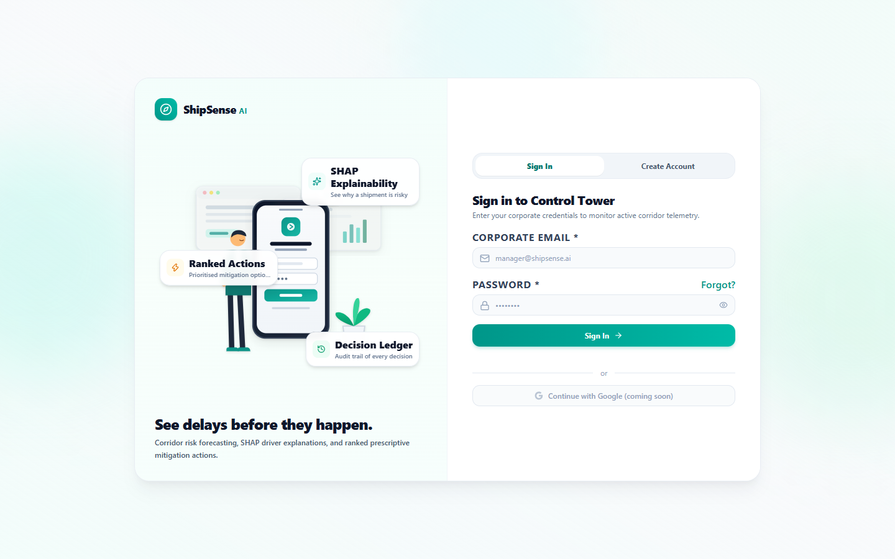
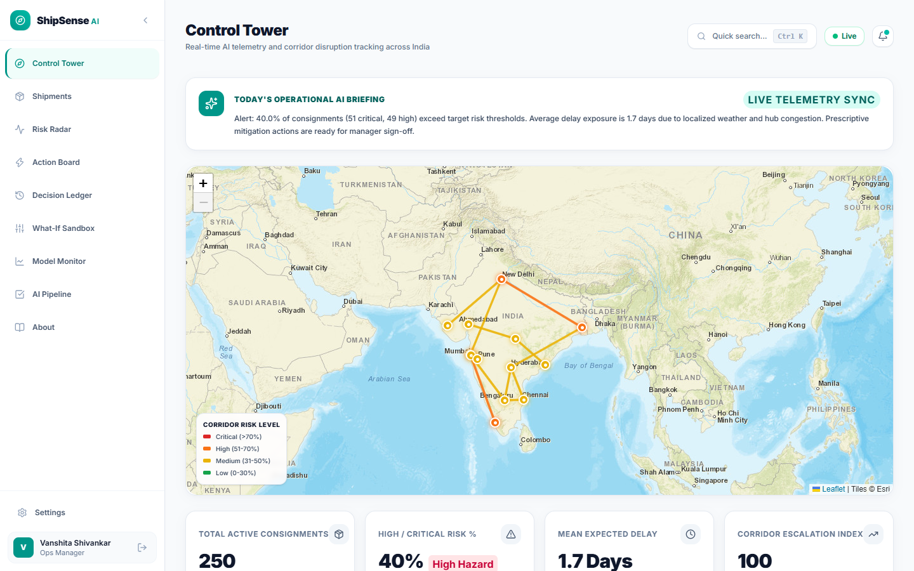
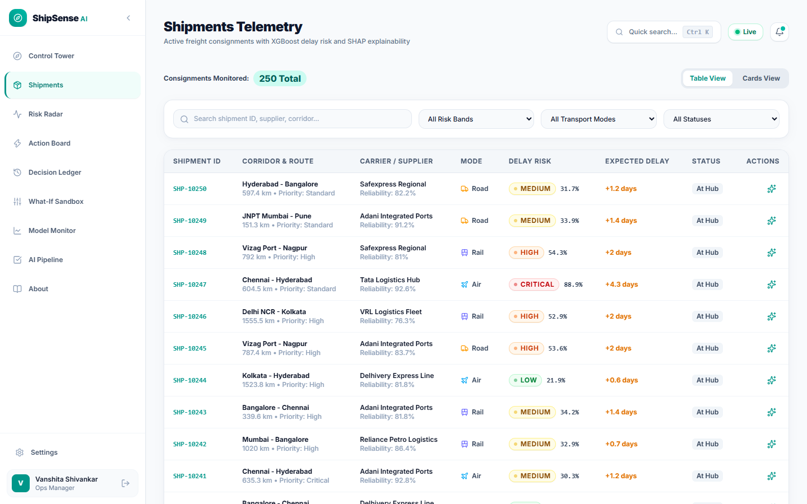
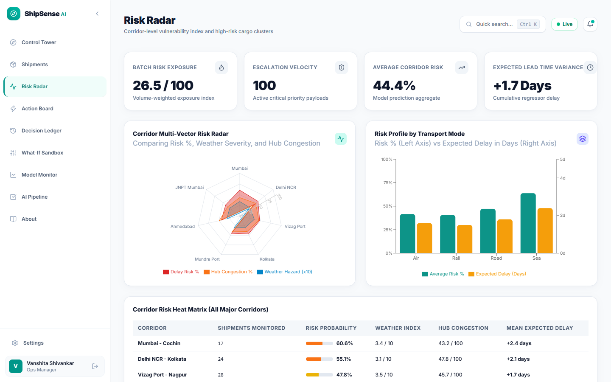
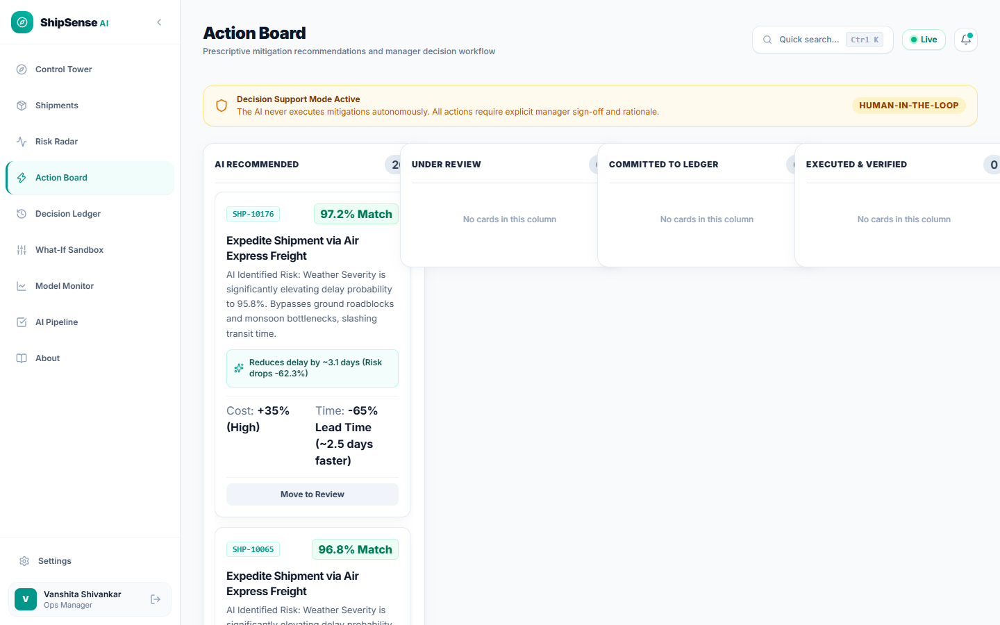
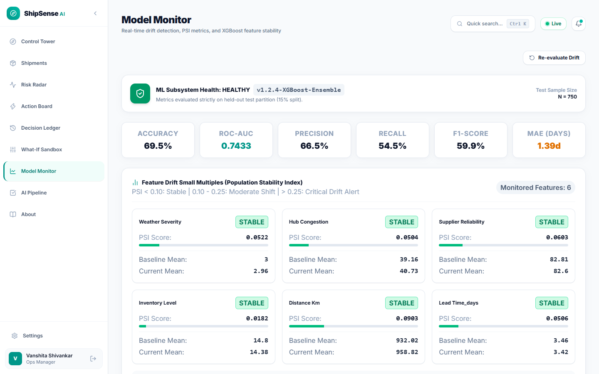
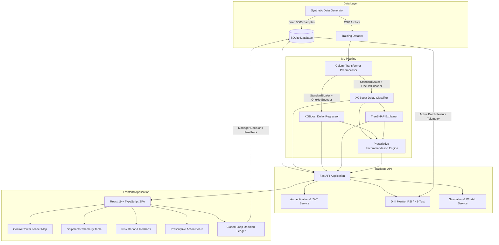

# ShipSense

AI-Powered Supply Chain Risk Prediction & Prescriptive Analytics Platform

[](https://www.python.org/)
[](https://fastapi.tiangolo.com/)
[](https://react.dev/)
[](https://xgboost.readthedocs.io/)
[](https://shap.readthedocs.io/)
[](https://www.sqlite.org/)
[](LICENSE)

---

## Overview

ShipSense is an end-to-end supply chain intelligence platform designed to predict freight transit delays before they occur and provide actionable, human-in-the-loop mitigation strategies. Using dual XGBoost models trained on multimodal corridor features, the system estimates delay probabilities and expected delay days for active consignments across India. TreeSHAP feature attributions explain the exact operational drivers behind every risk score, while a rule-assisted prescriptive engine ranks mitigation actions by cost, time, and risk reduction trade-offs. All manager decisions are committed to an immutable Decision Ledger to maintain a closed-loop audit trail, and an integrated drift monitor continuously tracks feature distributions using the Population Stability Index (PSI).

---

## Key Features

- **Authentication**: JWT-based session security with bcrypt password hashing, persistent sessions, and role selection (Operations Manager, Supply Chain Director, Risk Analyst).
- **Control Tower Map**: Interactive Leaflet geospatial map locked to Indian freight corridors using Esri English tiles, color-coded risk paths, and live telemetry synchronization.
- **Shipments Explorer**: Telemetry table with multi-attribute filtering (risk tier, transport mode, consignment status), search, and per-shipment modal drill-downs with SHAP waterfall breakdowns.
- **Risk Radar**: Corridor-level vulnerability index featuring multi-vector radar spider charts, dual-axis transport mode comparisons (delay risk % vs. expected delay days), and risk heat matrices.
- **Action Board**: Prescriptive Kanban board ranking mitigation strategies (air expedite, carrier reassignment, buffer buffer re-routing) with cost/time trade-off summaries and approval workflows.
- **Decision Ledger**: Governance audit log tracking manager sign-offs, mitigation rationale, and outcome comparisons for complete operational accountability.
- **What-If Sandbox**: Real-time counterfactual simulation tool enabling operators to test parameter changes (weather severity, congestion, transport modes) and observe updated risk predictions instantly.
- **Model Monitor**: Distribution drift tracker evaluating Population Stability Index (PSI), Wasserstein distance, and feature statistical comparisons against baseline training distributions.
- **AI Pipeline**: Pipeline execution monitoring, model registry parameters, and data lineage inspection.

---

## Screenshots

| View | Preview |
| :--- | :--- |
| **Login & Authentication** |  |
| **Control Tower Map** |  |
| **Shipments Telemetry** |  |
| **Risk Radar** |  |
| **Action Board** |  |
| **Decision Ledger** |  |
| **What-If Sandbox** |  |
| **Model Monitor** |  |

---

## Architecture



### Folder Structure

```text
ShipSense/
├── backend/
│   ├── app/
│   │   ├── api/v1/          # FastAPI route handlers (auth, shipments, risk, etc.)
│   │   ├── core/            # Configuration, database connection, JWT security
│   │   ├── models/          # SQLAlchemy database models
│   │   ├── schemas/         # Pydantic validation schemas
│   │   ├── services/        # Recommendation engine, ML service wrappers
│   │   └── main.py          # FastAPI application factory and middleware
│   ├── tests/               # Backend and ML integration tests
│   ├── .env.example         # Backend environment configuration template
│   └── requirements.txt     # Python backend dependencies
├── frontend/
│   ├── src/
│   │   ├── components/      # Modular UI components (map, auth, badges, layout)
│   │   ├── pages/           # Application views (Control Tower, Shipments, etc.)
│   │   ├── services/        # API client and backend connectors
│   │   ├── constants/       # Theme tokens, risk color palettes, map bounds
│   │   └── App.tsx          # Router layout and global state wrapper
│   ├── capture_app_screenshots.js # Puppeteer documentation screenshot script
│   ├── package.json         # Frontend package configuration
│   └── vite.config.ts       # Vite bundler configuration
├── ml/
│   ├── data/                # Seed CSV datasets and generation archives
│   ├── models/              # Serialized joblib models and baseline statistics
│   ├── drift.py             # PSI and statistical distribution drift calculator
│   ├── explain.py           # TreeSHAP explainer service and waterfall formatters
│   ├── generate_data.py     # Domain-specific synthetic shipment data generator
│   ├── seed_database.py     # Database population and pipeline bootstrapping
│   └── train.py             # Dual XGBoost model training and evaluation script
├── docs/
│   └── screenshots/         # Documentation visual assets
├── run_dev.py               # Concurrent development runner (FastAPI + Vite)
├── LICENSE                  # MIT License
└── README.md                # Project documentation
```

---

## Tech Stack

| Layer | Technology | Purpose |
| :--- | :--- | :--- |
| **Machine Learning** | XGBoost 2.1.3 | Gradient boosted decision trees for classification & regression |
| **Explainability** | SHAP 0.46.0 | TreeSHAP local and global feature attribution calculations |
| **Data Processing** | Scikit-learn 1.6.0, Pandas 2.2, NumPy 2.2 | Data transformation, scaling, one-hot encoding, and metrics |
| **Statistical Testing** | SciPy 1.15.0 | Kolmogorov-Smirnov and Wasserstein distance calculations |
| **Backend Framework** | FastAPI 0.115.6 | Asynchronous Python REST API framework |
| **Web Server** | Uvicorn 0.34.0 | ASGI web server |
| **ORM & Database** | SQLAlchemy 2.0.36 + SQLite 3 | Relational database schema, migrations, and queries |
| **Security & Auth** | Python-Jose 3.3.0 + Bcrypt 4.2.1 | JWT token generation, verification, and password hashing |
| **Frontend Framework** | React 19.2 + TypeScript 6.0 | Component architecture and type-safe UI logic |
| **Styling & Design** | Tailwind CSS v4 | Responsive design system and customized risk themes |
| **Data Visualization** | Recharts 3.10.1 | Radar charts, dual-axis bar charts, and metric trends |
| **Geospatial Mapping** | Leaflet 1.9.4 + React-Leaflet 5.0 | Interactive corridor mapping with Esri World Street tiles |
| **Animation & UX** | Framer Motion 14.1 | Page transitions and floating card micro-animations |
| **State Management** | Zustand 5.0 | Client-side session and telemetry state store |

---

## ML Details

### Model Architecture

ShipSense employs a dual-model machine learning architecture to forecast supply chain disruptions:

1. **Delay Risk Classifier**: `XGBoostClassifier` (`n_estimators=160`, `max_depth=5`, `learning_rate=0.06`, `subsample=0.85`, `colsample_bytree=0.85`, `eval_metric="logloss"`). Predicts the binary probability ($0.0$ to $1.0$) that a consignment will experience transit delays.
2. **Expected Delay Regressor**: `XGBoostRegressor` (`n_estimators=150`, `max_depth=5`, `learning_rate=0.05`, `subsample=0.85`, `colsample_bytree=0.85`, `eval_metric="mae"`). Estimates the magnitude of delay in days ($0.0$ to $10.0+$ days).

### Features Used

The pipeline processes 11 raw domain features mapped into 40 transformed inputs via `ColumnTransformer`:

- **Continuous Numerical Features (StandardScaler)**:
  - `distance_km`: Route distance in kilometers.
  - `lead_time_days`: Scheduled transit window in days.
  - `weather_severity`: Scaled weather severity index ($0$ to $10$).
  - `supplier_reliability`: Historical on-time delivery score ($0\%$ to $100\%$).
  - `hub_congestion`: Transit hub backlog and dwell index ($0\%$ to $100\%$).
  - `inventory_level`: Buffer inventory available at destination ($0$ to $50$ days).
- **Categorical Features (OneHotEncoder)**:
  - `origin`: Dispatch hub (Delhi NCR, Mumbai, Vizag Port, Kolkata, Chennai, Hyderabad, Bangalore, JNPT Mumbai, Mundra Port, Ahmedabad).
  - `destination`: Receiving hub (Hyderabad, Nagpur, Bangalore, Mumbai, Pune, Chennai, Cochin, Kolkata, Delhi NCR).
  - `transport_mode`: Road, Rail, Air, Sea.
  - `order_priority`: Standard, High, Critical.
  - `supplier_id`: Carrier identification code (SUP-101 through SUP-108).

### Dataset Split & Calibration

- **Partitioning**: Stratified 70% Training (3,500 records), 15% Validation (750 records), and 15% held-out Test (750 records) from 5,000 synthetic shipments.
- **Risk Categorization**: Predictions are mapped into calibrated operational risk bands:
  - **Low**: $0.0\% - 30.0\%$
  - **Medium**: $30.1\% - 50.0\%$
  - **High**: $50.1\% - 70.0\%$
  - **Critical**: $70.1\% - 100.0\%$
- **Explainability**: Local TreeSHAP attributions compute exact positive and negative SHAP force values for each feature on every inference call, highlighting primary delay risk drivers and risk-mitigating factors.

### Evaluation Metrics (Held-Out Test Set)

| Metric | Value | Interpretation |
| :--- | :--- | :--- |
| **Accuracy** | **69.47%** | Proportion of correct binary delay classifications |
| **Precision** | **66.54%** | Accuracy of positive delay alerts (low false alarms) |
| **Recall** | **54.46%** | Detection rate of actual delayed consignments |
| **F1-Score** | **59.89%** | Harmonic balance between precision and recall |
| **ROC-AUC** | **0.7433** | Discriminative ability across all classification thresholds |
| **MAE (Days)** | **1.39 days** | Average absolute error in expected delay prediction |
| **RMSE (Days)** | **1.75 days** | Root mean squared error penalizing large delay errors |

---

## Getting Started

### Prerequisites

- **Python**: Version `3.10` or higher (tested on Python `3.12`)
- **Node.js**: Version `18.0` or higher (tested on Node `20+`)
- **npm**: Version `9.0` or higher

### Installation Steps

1. **Clone the repository**:
   ```bash
   git clone https://github.com/your-username/ShipSense.git
   cd ShipSense
   ```

2. **Create and activate a Python virtual environment**:
   ```bash
   # Windows (PowerShell)
   python -m venv .venv
   .venv\Scripts\Activate.ps1

   # Linux / macOS
   python3 -m venv .venv
   source .venv/bin/activate
   ```

3. **Install Python dependencies**:
   ```bash
   pip install --upgrade pip
   pip install -r backend/requirements.txt
   ```

4. **Generate data, train ML models, and seed the database**:
   ```bash
   python ml/seed_database.py
   ```
   *This command creates the SQLite database, generates 5,000 synthetic shipments, trains the XGBoost Classifier and Regressor, outputs test metrics, serializes models to `ml/models/`, and populates 250 initial active consignments.*

5. **Install Frontend dependencies**:
   ```bash
   cd frontend
   npm install
   cd ..
   ```

6. **Start the development servers**:
   ```bash
   python run_dev.py
   ```
   *Alternatively, start backend and frontend in separate terminals:*
   ```bash
   # Terminal 1: Backend
   cd backend
   uvicorn app.main:app --host 127.0.0.1 --port 8000 --reload

   # Terminal 2: Frontend
   cd frontend
   npm run dev
   ```

### Local Access URLs

- **Frontend UI**: [http://localhost:5173](http://localhost:5173)
- **Backend API**: [http://127.0.0.1:8000](http://127.0.0.1:8000)
- **Interactive Swagger Docs**: [http://127.0.0.1:8000/docs](http://127.0.0.1:8000/docs)
- **ReDoc API Documentation**: [http://127.0.0.1:8000/redoc](http://127.0.0.1:8000/redoc)

> [!NOTE]
> **Account Registration**: The database is seeded without default user accounts. When opening the frontend for the first time, click **Create Account** on the login page to register your manager account.

---

## Environment Variables

ShipSense uses environment variables defined in `.env.example`. To customize configuration, copy `.env.example` to `.env` in the backend or project root:

```bash
cp .env.example .env
```

| Variable | Default Value | Description |
| :--- | :--- | :--- |
| `PROJECT_NAME` | `"ShipSense"` | Application platform name |
| `API_V1_STR` | `"/api/v1"` | API routing prefix |
| `SECRET_KEY` | `"<secret_key>"` | Cryptographic key used for signing JWT tokens |
| `ALGORITHM` | `"HS256"` | JWT token hashing algorithm |
| `ACCESS_TOKEN_EXPIRE_MINUTES` | `1440` | JWT access token validity period in minutes (24 hours) |
| `REFRESH_TOKEN_EXPIRE_DAYS` | `7` | JWT refresh token validity period in days |
| `DATABASE_URL` | `"sqlite:///./shipsense.db"` | SQLAlchemy database connection URI |
| `DEFAULT_SIMULATION_INTERVAL_SEC` | `5` | Active telemetry simulation tick rate in seconds |
| `SIMULATION_ENABLED` | `true` | Enables background synthetic telemetry streaming |

---

## API Overview

| Method | Endpoint | Description |
| :--- | :--- | :--- |
| `POST` | `/api/v1/auth/signup` | Register a new operations manager or analyst account |
| `POST` | `/api/v1/auth/login` | Authenticate user credentials and issue JWT bearer token |
| `GET` | `/api/v1/auth/me` | Retrieve the authenticated user profile |
| `GET` | `/api/v1/shipments/` | Retrieve paginated active shipments with risk filters and search |
| `GET` | `/api/v1/shipments/{id}` | Fetch single shipment telemetry with on-the-fly SHAP driver analysis |
| `GET` | `/api/v1/risk/corridor-summary` | Retrieve aggregated multi-vector risk and weather telemetry |
| `GET` | `/api/v1/risk/transport-modes` | Mode-level risk aggregation comparing delay % and delay days |
| `GET` | `/api/v1/recommendations/` | Retrieve ranked prescriptive mitigation actions |
| `POST` | `/api/v1/decisions/` | Record manager mitigation sign-off and rationale to the audit ledger |
| `GET` | `/api/v1/decisions/` | Retrieve immutable decision audit trail with outcome comparisons |
| `POST` | `/api/v1/simulation/what-if` | Compute real-time counterfactual predictions for parameter adjustments |
| `GET` | `/api/v1/monitoring/drift` | Compute Population Stability Index (PSI) and feature drift against baseline |
| `GET` | `/api/v1/model-info/` | Fetch model registry hyperparameters, feature mappings, and test metrics |
| `GET` | `/health` | Application health check endpoint |

---

## Limitations

- **Synthetic Data**: All shipment telemetry, weather indices, and congestion metrics are generated using statistical simulations and domain heuristics rather than live telematics devices or real carrier APIs.
- **No Direct Carrier / ERP Integration**: The application does not connect to live enterprise ERPs (SAP, Oracle TMS) or EDI/GPS sensor streams.
- **Metrics Applicability**: Reported test set metrics (accuracy, ROC-AUC, MAE) are measured strictly against the synthetic distribution and should be re-evaluated on production logistics records.
- **Map Tile Dependency**: Geospatial mapping relies on Esri World Street Map tiles and requires continuous internet connectivity and standard provider attribution.
- **Local Storage**: The default configuration utilizes SQLite, which is designed for local evaluation and single-node demonstrations. Production deployments require a PostgreSQL instance and Redis cache.

---

## Future Improvements

1. **Graph-Based Multimodal Routing**: Implement Dijkstra / A* route graph optimization across road, rail, air, and coastal networks to dynamically compute multi-leg detour routes.
2. **Real-Time IoT Ingestion**: Integrate Apache Kafka / MQTT event streams to ingest continuous GPS, temperature, and shock sensor telematics from active containers.
3. **Automated CD4ML Retraining**: Set up automated model retraining pipelines triggered when feature PSI drift exceeds critical thresholds ($PSI > 0.25$).
4. **Enterprise Multi-Tenancy & RBAC**: Expand role-based access control to support distinct carrier portals, shipper views, and 3PL dispatch accounts.
5. **LLM Prescriptive Escalations**: Integrate generative AI assistants to draft contextual supplier escalation notices and carrier rerouting requests automatically upon manager approval.

---

## Author

**Vanshita Shivankar**

- GitHub: [github.com/vanshita-html](https://github.com/vanshita-html)

---

## License

This project is licensed under the MIT License - see the [LICENSE](LICENSE) file for details.
